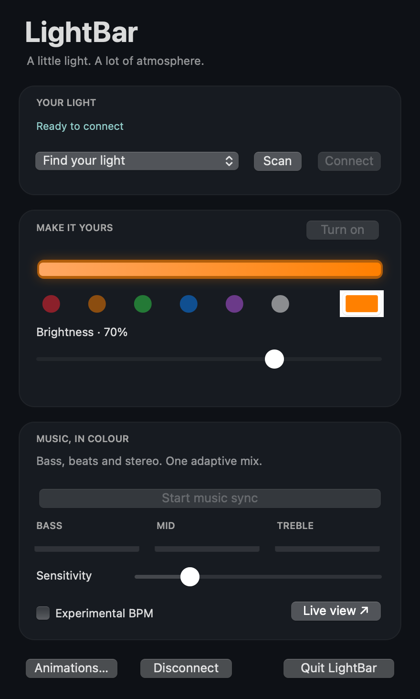
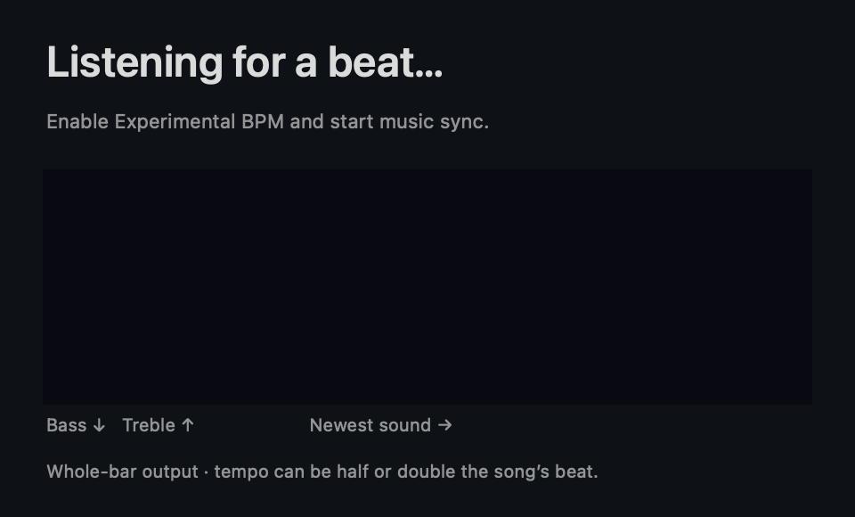
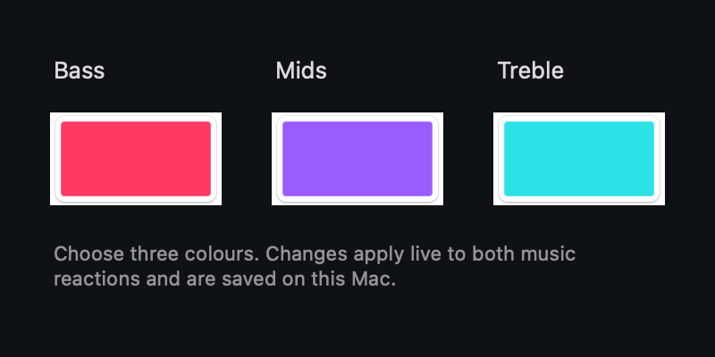
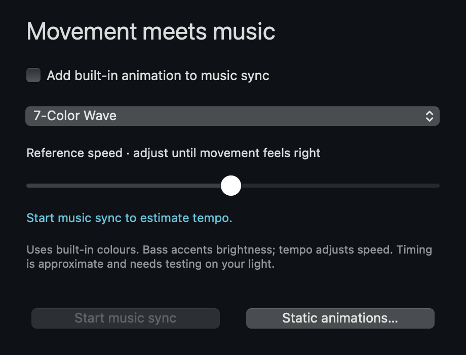

# LightBar

A native macOS menu bar app for Bluetooth LED lights using duoCo StripX-compatible controllers. Includes power, colour, brightness, built-in animations, and one adaptive computer-audio music mode.



## Download and install

Download **LightBar-macOS-universal.zip** from [Releases](https://github.com/BalaajiSri/LightBar/releases/latest). Unzip it, move **LightBar.app** to **Applications**, and open it. Click the 💡 menu bar icon to open the controls.

Requires **macOS 13 or newer**, on Apple Silicon or Intel. This release is for Macs, not iPhone, iPad, Android, Windows, or Linux. Downloads are public; no GitHub account is required.

The app is locally ad-hoc signed and is not Apple-notarized. macOS may require approval under **System Settings → Privacy & Security → Open Anyway** after your first attempt to open it.

## Connect your light

1. Power on the light near the Mac.
2. Fully close the phone app: many controllers accept one Bluetooth connection at a time.
3. Allow Bluetooth access when prompted.
4. Choose the light and click **Connect**. Use **Scan** to retry.

The last selected device is remembered. Reopening scans for 12 seconds; unexpected disconnection triggers another scan. Controls represent requested settings, not live device state.

If the menu bar is crowded, macOS may hide the icon near the notch. Reopen LightBar from Applications to bring up the control panel.

## React to computer audio

Connect the light and click **Start music sync**. One adaptive mix combines warm bass, violet middle frequencies, cyan treble, bass-onset accents, and a gentle colour bias from stereo balance. Live meters show the three frequency bands. Play audio and adjust sensitivity and brightness. Built-in device animations remain available under **Animations…**.

Allow LightBar under **System Settings → Privacy & Security → Screen & System Audio Recording** (called Screen Recording on some versions), then quit and reopen if requested. Replacing an ad-hoc signed build can invalidate the previous permission entry. If capture is denied despite an enabled switch, remove the LightBar entry, add the installed copy from Applications, and enable it again.

Audio is processed locally using Apple's ScreenCaptureKit; no audio is saved or uploaded. Only audio output is processed, with microphone capture disabled. macOS may show a recording indicator because the framework uses a display filter. Some protected audio may be unavailable.

Bass, middle-frequency energy, treble, and stereo balance come from audio analysis. Middle-frequency analysis includes instruments as well as vocals; it does not isolate the singer. Onsets are not exact tempo tracking. Known Bluetooth streaming commands affect the **whole bar**; independent region control has not been verified. The combined music mode controls the whole bar; it does not claim region or per-pixel control.

Stop restores the selected colour or animation. Capture also stops on disconnect, quit, or a capture error. Closing the panel leaves the app running; use **Quit LightBar** to exit.

## Build from source

Install Apple's Xcode Command Line Tools, then run:

```sh
zsh build.sh
```

This produces a universal Apple Silicon / Intel app at `build/LightBar.app` and a distributable `LightBar.zip`. No third-party runtime dependencies are required. The build compiles both architectures, ad-hoc signs the app, verifies the signature, and runs protocol/audio tests on the host architecture. Intel runtime behaviour still needs testing on an Intel Mac.

To run the checks independently:

```sh
build/LightBar.app/Contents/MacOS/LightBar --test
```

GitHub Actions builds the app and uploads the ZIP as a workflow artifact. Release downloads are published separately.

## Compatibility and credits

Developed with a **MELK-OA21** controller. Other duoCo StripX devices may differ. Discovery recognises MELK / duoCo names or service FFF0, and verifies characteristic FFF3 supports writes without response. The app sends basic lighting commands, not pixel-count, wiring-order, or persistent controller-configuration commands.

Protocol research and effect names are based on [Corner-Floor-Lamp-Controller](https://github.com/wxx9248/Corner-Floor-Lamp-Controller). Third-party material retains its original rights; this repository does not grant a separate license to that material.

Diagnostic connection and command events are written locally to `LightBar.log` in the macOS user temporary directory. Captured audio and audio-level streams are not logged. Live music effects require testing with each physical controller; automated signal and protocol checks cannot verify visible LED response.

## App design

The app has a custom macOS icon, a persistent control panel, and a menu bar shortcut. The screenshot above is a rendered disconnected-state preview, not evidence of a connected light. The new combined effect has automated protocol and signal-analysis coverage; visible behaviour on individual controllers still needs user testing.

## Experimental BPM and spectrum lab (0.4 prerelease)

Start music sync, then enable **Experimental BPM**. This optional addition starts **off** each time the app opens; leave it off for the existing music reaction. **Live view** opens a separate panel with estimated tempo and a scrolling, 16-band frequency history (bass at the bottom, treble at the top, newest sound at the right).

The experimental renderer blends warm bass, violet mids, cyan highs and stereo balance. Quiet phrases diffuse slowly through colours; higher sustained energy brings stronger bass accents and estimated-beat pulses. The lamp still receives a single RGB value for the whole bar at up to 10 Hz. The spectrogram is in the app, not independent regions on the physical lamp.

Tempo estimation uses positive changes in bass/treble energy, resampled to 50 Hz, with autocorrelation over up to 12 seconds. It searches approximately 60–180 BPM and needs several seconds of steady rhythm. Rhythm confidence is a heuristic periodicity score, not a calibrated probability. Uncertain rhythm falls back to spectrum/onset response. Silence suppresses intensity and stale rhythm confidence. Genre targets for the first trial are hip-hop, EDM, pop, and hyperpop; this is not a genre classifier.

Syncopation, tempo changes, weak drums, and half/double-time beats can give an incorrect estimate. There is no isolated-vocal recognition, exact beat-grid guarantee, or real-song accuracy claim. Synthetic 90/120/150 BPM tests, missing-beat recovery, spectrum localisation, silence, and bounded-output checks pass; live songs and physical light response still require user testing.



## Choose your music colours (0.4.1)

Use the palette menu under **Music, in colour** in either the classic or experimental reaction:

- **Neon**: pink, violet, cyan (default).
- **Sunset**: coral, rose, violet.
- **Aurora**: mint, sky blue, lilac.
- **Ember**: red, amber, gold.
- **Ocean**: cobalt, teal, mint.
- **Single colour**: use the main colour picker, with music controlling intensity.
- **Custom palette**: click **Edit colours…** and choose bass, mids and treble colours.
- **Original spectrum**: use the original renderer's colours.

Palette changes apply during music playback without restarting capture. Colours blend according to relative frequency energy; experimental mode blends more gradually. The chosen palette and custom colours are stored locally and restored on the next launch. The bar still shows one mixed colour at a time. The app's audio-capture implementation is unchanged in this update.



## Animation Studio (0.5 prerelease)

Open **Animation Studio** from the main panel. This new section adds an optional built-in-animation layer to music sync:

1. Choose a pattern (the initial selection is **7-Color Wave**).
2. Enable **Add built-in animation to music sync**.
3. Start music sync from either window.
4. Adjust **Reference speed** until movement feels appropriate.

Tempo analysis runs when the animation layer is enabled, including when the separate Experimental BPM renderer is off. Once rhythm confidence is sufficient, the controller speed setting scales from the reference speed using estimated BPM / 120, clamped to 1–100. This is an uncalibrated heuristic: different animations can interpret speed differently, and it does not phase-lock a movement to the beat. With uncertain tempo, reference speed is used.

The existing audio envelope (classic or experimental) drives brightness accents, capped by the main brightness slider. Silence dims the pattern to zero. Speed commands are limited to about once per second; brightness updates use the existing audio tick and Bluetooth backpressure checks. Live colour streaming is suspended while the built-in pattern runs so those commands do not override it.

Built-in patterns use their own colours. Custom music palettes resume when you disable the animation layer. The main preview shows animation intensity using a neutral colour, not the pattern's actual regional colours. On stopping music sync, brightness is restored and the selected pattern remains as a static controller effect. **Static animations…** retains access to the previous built-in-animation menu.

The section starts with the layer off. The audio-capture implementation is unchanged. Synthetic signal, tempo, protocol, speed-scaling, brightness-cap and silence checks pass; the panel was visually inspected. Whether this controller preserves each pattern while changing brightness/speed still requires a physical-light trial.


